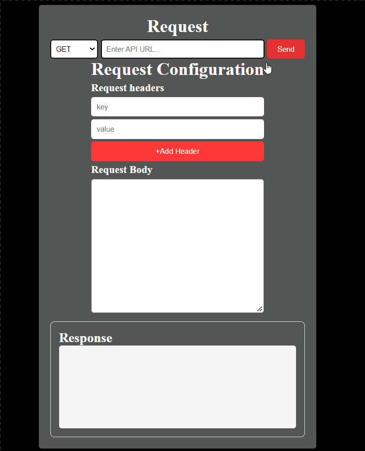
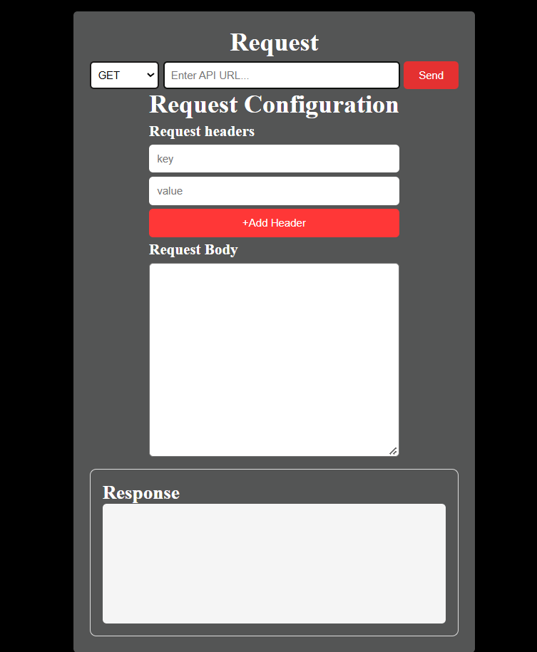

# MINI-API-TESTER
It is an simple website that helps to send HTTP request to APIs and see their responses.

here's an AWESOME gif of my project!
;


## Demo Link
[Here is live demo of my project](https://mini-api-tester-navy.vercel.app/)

## Screenshots
;

## HOW THIS WAS MADE
i want to create little version of post man i often used to check my backend api.And i also want to understand how the http request work that why i planeed to make it.

## WHAT DOES IT DO?

it helps user to send request to APIS using different HTTP methods and see the responses.

## Features
1. it support GET,POST,PUT,PATCH,DELETE.
2. you can add custom request headers.
3. send json request body.
4. view response status and json data

## What it can and cannot do
1. it can test publicly accesssible APIs.
2. it can also test locally runnign APIs when ```Mini API Tester ``` is also runnign locally 
3. the deployed version cannot directly acces APIs running on computer localhost.
4. it currrently support json request bodies and json response.

## Tech Stack
1. HTMl
2. CSS
3. Javascript
4. Node js
5. Express js


1. Clone the repository:
```sh
git clone https://github.com/Saurav-Khanal/MINI-API-TESTER
```

2. Navigate to the project directory:
```sh
cd mini-api-tester
```

3. Install dependencies:
```sh
npm install
```

5. Start the development server:
```sh
node server.js
```

6. Open your browser and visit:
```text
http://localhost:3000
```
## Problem faced
i faced some difficulties while collecting headers using a for loop and storing the key and value in an object.i was also confued about what data to send using fetch.i used ai to understand these part and finally fixed them with my own logic.

## AI DISCLOUSURE
i used ai for development debugging when my logic was not working even after trying more times.
i also used it to understan some unexpected errors and fix them, 
especially while working with ``` loops and fetch ```. 


